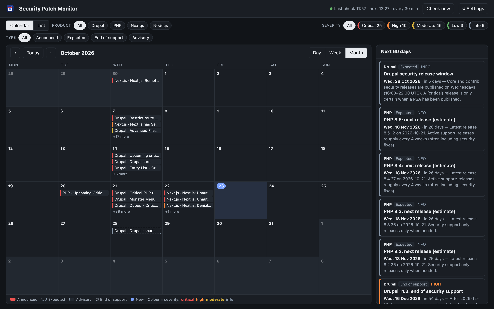
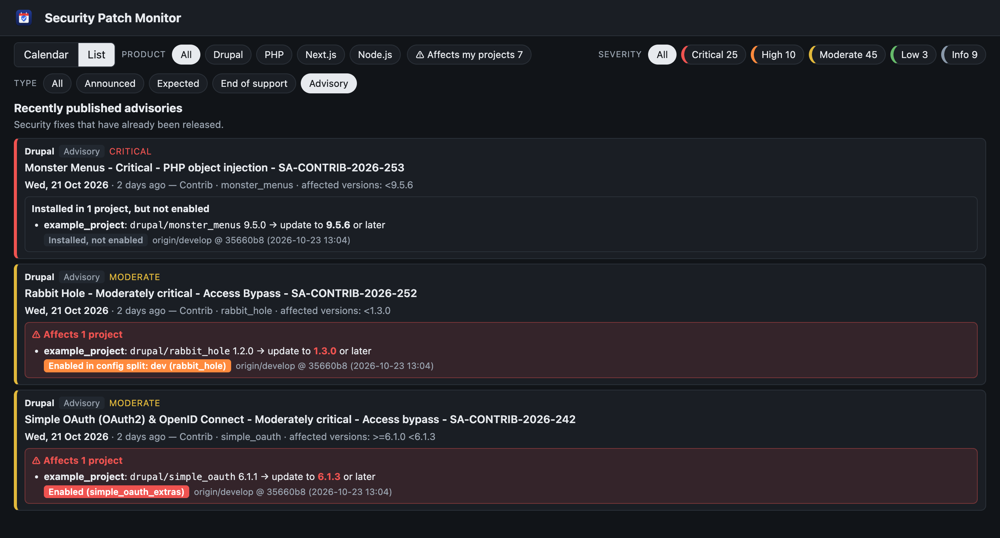

<p align="center">
  
</p>

<h1 align="center">Security Patch Monitor</h1>

<p align="center">
  A desktop calendar of <strong>announced</strong>, <strong>expected</strong> and <strong>released</strong>
  security patches for <strong>Drupal</strong> (core and contrib), <strong>PHP</strong>,
  <strong>Next.js</strong> and <strong>Node.js</strong>, with notifications when something new appears.
</p>



## Key features

- **Calendar of security patches** – pre-announced releases, expected release windows, end-of-support dates
  and published advisories in a day, week or month view, plus a list view.
- **Automatic checks and notifications** – checks every 30 minutes while the app is open (configurable) and
  sends a system notification when new items appear.
- **"Does this affect my projects?"** – add your Drupal projects and every Drupal core and contrib advisory
  is checked against their `composer.lock`, with the version to update to.
- **Enabled or just installed?** – the exported `core.extension.yml` shows whether a vulnerable module is
  actually enabled, only enabled in a config split, or installed but switched off.
- **Reads the latest `develop`** – projects can be checked against the newest commit on `origin/develop` (or
  any branch) without touching your local checkout, or against your local files.
- **Filters** – by product, severity, type and "affects my projects".
- **Native desktop app** – macOS app with its own icon; also runs in a browser or exports JSON/HTML reports.

---

## Contents

- [Key features](#key-features)
- [Why](#why)
- [Feature details](#feature-details)
- [Installation](#installation)
- [Usage](#usage)
- [Projects: is my site affected?](#projects-is-my-site-affected)
- [What counts as "upcoming"](#what-counts-as-upcoming)
- [Data sources](#data-sources)
- [Configuration and data](#configuration-and-data)
- [Architecture](#architecture)
- [Security](#security)
- [Development](#development)
- [Extending: adding a source](#extending-adding-a-source)
- [Troubleshooting](#troubleshooting)

## Why

Security releases for the platforms we maintain are announced in different places, in different formats and
with different lead times: Drupal publishes PSAs a few days ahead, Node.js pre-announces about a week in
advance, PHP posts on php.net and Next.js only publishes advisories once a fix is out. This app collects all of
it in one calendar, so you can plan update windows instead of reacting to them.

The app informs you about upcoming patches for everything, and can additionally tell you which of
**your Drupal projects** are affected by a core or contrib advisory, based on their `composer.lock` and
`core.extension.yml`. It never changes your projects or contacts your servers.

## Feature details

| | |
|---|---|
| **Calendar** | Day, week and month views (month by default). Click a day for its items in the side panel, double-click to open the day view. The side panel shows the next 60 days. |
| **List view** | All items grouped by type: announced, expected, end of support and advisories. |
| **Filters** | Product, severity and type. Clicking a filter shows *only* that value; click more values to combine them, click an active value to remove it, and **All** resets the group. |
| **Automatic checks** | While the app is open it checks every 30 minutes by default. The interval is configurable in **⚙︎ Settings**. **Check now** runs a check immediately. |
| **Notifications** | A system notification when new items appear (on by default, can be turned off in Settings). New items are marked with **●** until you click **Mark as seen**. |
| **Projects** | Add your Drupal projects (name + `composer.lock`) in Settings. Every Drupal contrib advisory is checked against the installed versions and shows **⚠ Affects …** with the version to update to. |
| **Resilient** | A failing source is shown as a warning; all other sources keep working. |
| **Exports** | `--json` for scripts and `--html` for a single self-contained, shareable calendar file. |
| **Keyboard** | <kbd>←</kbd> <kbd>→</kbd> navigate, <kbd>t</kbd> today, <kbd>d</kbd> / <kbd>w</kbd> / <kbd>m</kbd> switch view. |

## Installation

Requirements: **Python 3.11+**. The desktop window uses [pywebview](https://pywebview.flowrl.com/); without it
the app opens in your browser.

```bash
git clone <repository-url> security-patch-monitor
cd security-patch-monitor
make install          # creates .venv and installs the app with desktop + dev extras
```

Without `make`:

```bash
python3 -m venv .venv
.venv/bin/pip install -e ".[desktop]"
```

### macOS app

```bash
make app              # builds ~/Applications/Security Patch Monitor.app
```

The bundle has its own name and icon in Finder, the Dock and Spotlight. It runs the code from this checkout,
so pull and rerun `make app` to update.

## Usage

```bash
security-patch-monitor                 # desktop window
security-patch-monitor --browser       # in your default browser (http://127.0.0.1:8765)
security-patch-monitor --json          # print one report as JSON and exit
security-patch-monitor --html out.html # write a self-contained HTML calendar and exit
security-patch-monitor --help
```

| Option | Description |
|---|---|
| `--browser` | Open the UI in a browser instead of a desktop window. |
| `--port N` | Port for the local UI server (default: random free port, `8765` with `--browser`). |
| `--json` / `--html FILE` | One-off report; does not affect the notification state of the app. |
| `--data-dir DIR` | Where settings, state and logs are stored (see below). |
| `-v`, `--verbose` | Debug logging. |
| `--version` | Print the version. |

The exit code of `--json` / `--html` is `1` only when every source failed, so it can be used in cron jobs.

## Projects: is my site affected?



1. Open **⚙︎ Settings** → **Projects** → **Add project**.
2. Enter a name and choose the project's `composer.lock` with **Browse…** (or paste the path; a project
   directory works too).
3. Choose where to read the project from:
   - **Latest commit on branch** `origin/develop` (default) – what is on develop right now, even if your
     local checkout is behind or has uncommitted changes;
   - **Local files** – the working copy as it is on disk.
4. Done. Projects are saved immediately. **Edit** changes the name, the `composer.lock` or the source (the
   new values are validated first; on an error nothing changes), and **Remove** deletes a project (click twice
   to confirm).

For every **Drupal core and contrib advisory** the app checks each project in two steps:

1. **Installed version** – the affected range from the advisory (for example `>=6.1.0 <6.1.3`) is compared with
   the version in `composer.lock`, including indirect and dev dependencies. A match shows
   *update to 6.1.3 or later*.
2. **Enabled?** – the exported configuration (`core.extension.yml`, usually in `config/sync/`) tells whether the
   module, or one of its submodules, is enabled:

| Status | Meaning |
|---|---|
| **Enabled** | Enabled in the main configuration. The name in brackets is the (sub)module that is enabled. |
| **Enabled in config split: dev** | Only enabled in a config split (`config/split/<name>/`), i.e. in some environments. |
| **Installed, not enabled** | The code is present but the module is off. Shown as "Installed in … but not enabled", not counted as affected and never the subject of an urgent notification. Update it anyway. |
| **Enabled state unknown** | No `core.extension.yml` was found; treated as affected to be safe. |
| **Drupal core (always enabled)** | A core advisory matched the locked `drupal/core` version. |

Every line also shows where the data came from, e.g. `origin/develop @ 35660b8 (2026-10-23 13:04)`.
Advisories for modules your projects use in a safe version show *✓ Not affected in your projects*. The
**⚠ Affects my projects** filter, the ⚠ calendar marker and notifications only count projects where the module
is (or may be) enabled.

### How the git branch is read

- Before every check the app runs `git fetch origin <branch>` in the project's repository (at most once every
  5 minutes per branch). This only updates the remote-tracking ref `origin/<branch>`: your working copy, your
  checked-out branch and local changes are never touched.
- `composer.lock` and `core.extension.yml` are then read with `git show origin/<branch>:<path>`, straight from
  the git object database.
- Git uses your normal credentials (SSH agent / keychain) but is never allowed to prompt. If fetching fails –
  offline, VPN not connected, key not loaded – the last fetched commit is used and the project shows
  *Could not fetch develop (…); using the last fetched commit*.
- Contrib code is usually not committed, so submodules are discovered from the local `web/modules/contrib/`.

With **Local files**, changes are picked up within a minute after `composer update` or `drush config:export`.
Other products (PHP, Node.js, Next.js) are informational only.

## What counts as "upcoming"

Nobody can predict a security release, so every item says what it is based on:

| Type | Meaning | Calendar style |
|---|---|---|
| **Announced** | Officially pre-announced: Drupal PSA, php.net announcement or Node.js pre-announcement with a future date. | Filled block |
| **Expected** | A schedule or estimate, not confirmed: the weekly Drupal security window (Wednesday 16:00–22:00 UTC) and the next regular PHP release per branch (≈ 4-week cadence). | Dashed outline |
| **End of support** | The date after which a version line receives no more security patches. Shown up to 365 days ahead. | ⏻ prefix |
| **Advisory** | A fix that has already been published (last 60 days). | Plain block |

The colour of an item is its severity: critical, high, moderate, low or info.
Expected items never trigger a notification, because they move every week.

## Data sources

| Product | Source | Used for |
|---|---|---|
| Drupal | [drupal.org/security/psa](https://www.drupal.org/security/psa) (RSS) | Pre-announcements of (highly) critical releases |
| Drupal | [drupal.org/security](https://www.drupal.org/security) core and [contrib](https://www.drupal.org/security/contrib) (RSS) | Published advisories, incl. affected versions |
| PHP | [php.net news](https://www.php.net/feed.atom) (Atom) | Security announcements and advisories |
| PHP | [php.net releases](https://www.php.net/releases/feed.php) (Atom) | Release cadence per branch for estimates |
| Node.js | [nodejs.org vulnerability blog](https://nodejs.org/en/feed/vulnerability.xml) (RSS) | Pre-announced and published security releases |
| Next.js | [GitHub Advisory Database](https://github.com/advisories?query=ecosystem%3Anpm+next) (REST) | Advisories with affected and patched versions |
| All | [endoflife.date](https://endoflife.date) (REST) | End of security support per version line |

Next.js does not pre-announce security releases; they appear as advisories once published.
Unauthenticated GitHub requests are limited to 60 per hour, which is plenty for the default interval. Set
`GITHUB_TOKEN` for a higher limit.

## Configuration and data

Settings are changed in the app (**⚙︎ Settings**) and stored, together with state and logs, in the
platform's data directory:

| Platform | Location |
|---|---|
| macOS | `~/Library/Application Support/Security Patch Monitor/` |
| Linux | `$XDG_CONFIG_HOME/security-patch-monitor/` (default `~/.config/…`) |
| Windows | `%APPDATA%\Security Patch Monitor\` |

Override with `--data-dir` or the `SPM_DATA_DIR` environment variable.

| File | Contents |
|---|---|
| `settings.json` | `interval_minutes` (1–1440, default 30), `notifications` (default `true`), `history_days` (default 60), `eol_warning_days` (default 365). Invalid values fall back to defaults. |
| `projects.json` | Your projects: name, path to `composer.lock` and the branch to read (or local files). |
| `seen.json` | Items you were already notified about, kept for a year. Delete it to start fresh; the first check after that records everything silently. |
| `app.log` | Rotating log (3 × 1 MB). |

| Environment variable | Purpose |
|---|---|
| `GITHUB_TOKEN` | Optional token for the GitHub Advisory API (no scopes needed). |
| `SPM_DATA_DIR` | Alternative data directory. |

## Architecture

```
src/patch_monitor/
├── cli.py               Entry point and composition root (the only place concrete classes are wired)
├── models.py            Item, Report and the Product / Kind / Severity enums
├── sources/             One module per vendor, each implementing the Source protocol
│   ├── base.py          Source protocol + SourceContext (http client, today, settings)
│   ├── drupal.py        PSAs, core/contrib advisories, release window
│   ├── php.py           php.net news, release estimates
│   ├── node.py          Node.js security feed
│   ├── nextjs.py        GitHub advisories for Next.js
│   └── endoflife.py     endoflife.date (end of support; shared by php.py)
├── report.py            ReportBuilder: runs sources in parallel, isolates failures, de-duplicates
├── monitor.py           Scheduling, new-item detection, notifications, settings changes
├── projects.py          Projects (name + composer.lock + branch): validation, persistence, lock parsing
├── project_files.py     ProjectFiles: read a project from the working tree or a git commit; git fetch
├── project_reader.py    Per-project state (locked versions, enabled extensions, source), cached per commit
├── drupal_config.py     core.extension.yml discovery and parsing, config splits, submodules
├── impact.py            Which projects an advisory affects (locked version, enabled state)
├── version.py           Version parsing and constraint matching (Drupal / npm range syntax)
├── notifications.py     Notifier protocol + macOS / Linux / Windows implementations
├── settings.py          Validated Settings + JSON store
├── seen.py              Store of already-notified items
├── storage.py           Data directory resolution, atomic writes
├── http.py              HttpClient protocol, urllib client (timeouts, retries, size limit), per-check cache
├── feeds.py / text.py   Safe RSS/Atom parsing and pure text/date helpers
├── desktop.py           pywebview window, native file dialog, macOS Dock name and icon
└── web/
    ├── server.py        Loopback HTTP server + JSON API
    ├── assets.py        Static files and the self-contained HTML export
    └── static/          index.html, app.css, app.js, icons
```

How the pieces relate:

```
 sources ──► ReportBuilder ──► Monitor ──► LocalServer (JSON API) ──► web UI (pywebview / browser)
    ▲                             │
 HttpClient          SeenStore · SettingsStore · Notifier
```

Design principles (SOLID):

- **Single responsibility** – fetching, parsing, scheduling, persistence, notifications and presentation live in
  separate modules.
- **Open/closed** – a new data source is a new class added to `default_sources()`; nothing else changes.
- **Liskov / interface segregation** – collaborators are small `Protocol`s (`Source`, `HttpClient`, `Notifier`,
  `SettingsStore`, `SeenStore`, `ProjectStore`, `ProjectFiles`, `ImpactAssessor`, `ReportProvider`, `MonitorApi`, `ProjectsApi`,
  `FilePicker`). The web layer only sees the methods it needs.
- **Dependency inversion** – high-level code depends on those protocols; `cli.py` injects the concrete
  implementations, and the tests inject fakes (no network, disk or real time required).

The front end is plain HTML/CSS/JavaScript without a build step. `app.js` keeps a single `state` object and
re-renders from it; event handlers only change state.

## Security

The UI talks to a small HTTP server on the same machine. Because any web page in a local browser could try
to reach it, the server:

- listens on `127.0.0.1` only;
- rejects requests with a foreign `Host` header (protects against DNS rebinding);
- requires a random per-session token on every API call (protects against cross-site requests);
- accepts only small JSON bodies and validates every setting;
- sends a strict Content-Security-Policy, `nosniff` and `no-referrer` headers.

Remote content is treated as untrusted: XML is parsed with `defusedxml`, only HTTPS is fetched with timeouts
and a response size limit, everything shown in the UI is HTML-escaped, and links are restricted to `https://`.
Notification text is passed as arguments, never through a shell.

## Development

```bash
make install     # editable install with dev tools
make check       # ruff lint + format check, mypy --strict, pytest
make test        # tests only
make format      # auto-format
make run         # start the app
make icon        # regenerate icons from tools/make_icon.py (needs Pillow)
```

The tests run without network access: sources are tested against small inline feeds through a fake
`HttpClient`, the monitor with a fake clock and temporary directories, and the web server over a real
loopback socket.

## Extending: adding a source

1. Create a class with a `name` and a `collect(ctx: SourceContext) -> list[Item]` method in
   `src/patch_monitor/sources/`. Use `ctx.http` for requests, `ctx.today` instead of the system clock and
   `ctx.history_start` for the history window.
2. Add it to `default_sources()` in `sources/__init__.py`.
3. Add a test with a fixture response in `tests/test_sources.py`.

A new product additionally needs a `Product` member in `models.py` and an entry in `PRODUCTS` in `app.js`.

## Troubleshooting

| Problem | Solution |
|---|---|
| A warning "Sources with errors" | One feed was unreachable or changed format. Other sources keep working; details are in `app.log`. |
| No notifications on macOS | Allow notifications for **Script Editor** in System Settings → Notifications (macOS shows notifications sent via `osascript` under that name). |
| GitHub rate limit errors | Set `GITHUB_TOKEN`, or use a longer check interval. |
| The app opens in the browser | pywebview is not installed: `pip install -e ".[desktop]"`. |
| A project shows "composer.lock not found" | The project moved or the lock file was deleted. Remove the project and add it again. |
| An advisory is not matched | Only Drupal contrib advisories are checked, and only for projects whose `composer.lock` contains that module. Development branches such as `dev-1.x` cannot be compared. |
| "Could not fetch develop" | Check VPN/network and that your SSH key is loaded (`ssh-add -l`). The last fetched commit is used meanwhile. |
| "Branch origin/develop not found" | The repository has no such branch on `origin`; **Edit** the project and choose another branch or **Local files**. |
| "Enabled state unknown" | No `core.extension.yml` found within 7 directory levels (outside `vendor`, `web/core`, `modules`, …). Export the configuration with `drush config:export`. |
| Reset everything | Quit the app and delete the data directory listed above. |
